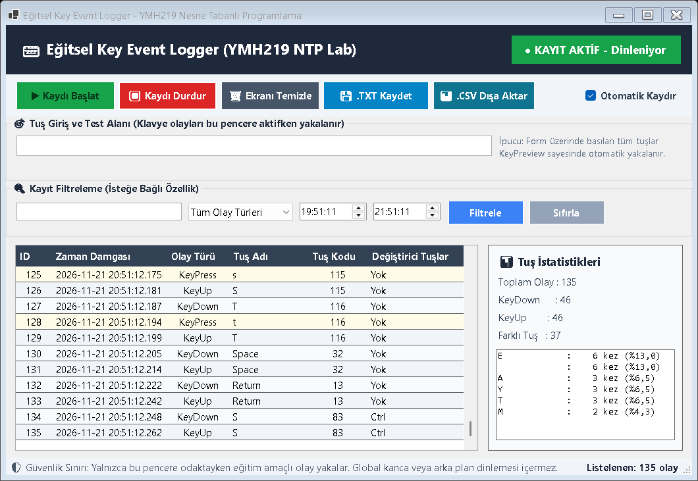
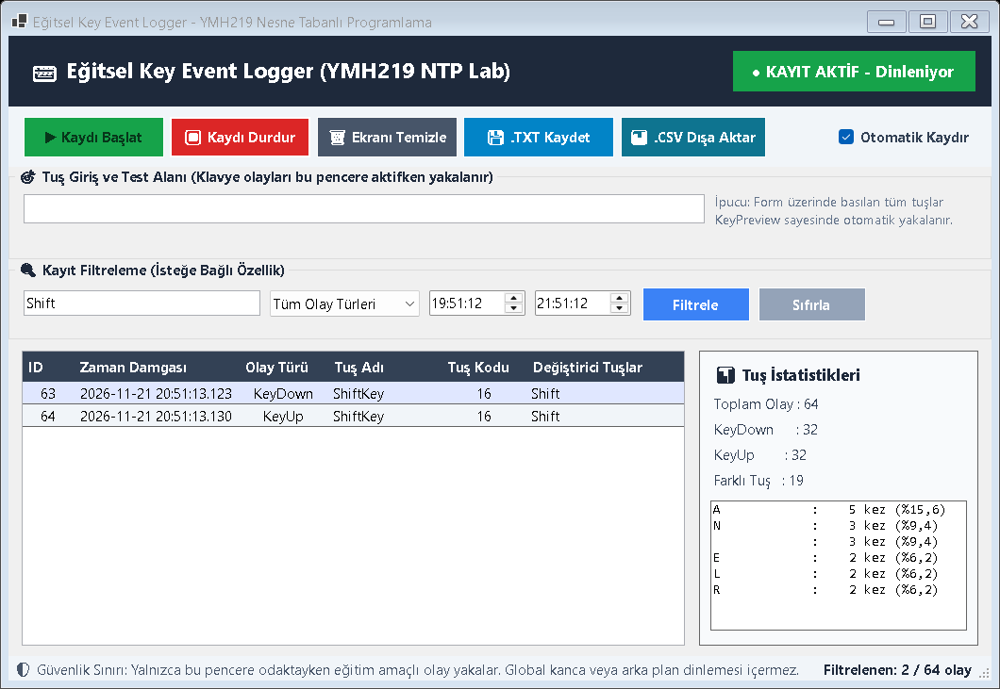

# YMH219 - Eğitsel Key Event Logger (Tuş Olay Kaydedici)


Bu proje, **Nesne Tabanlı Programlama (YMH 219)** dersi laboratuvar / ek uygulama ödevleri kapsamında geliştirilmiş nesne yönelimli bir **Eğitsel Key Event Logger** masaüstü uygulamasıdır.

Uygulama, Windows Forms ortamında klavye giriş olaylarının (`KeyDown`, `KeyUp`, `KeyPress`) nesne tabanlı mimari ile nasıl dinlendiğini, modellendiğini, istatistiksel analizlere tabi tutulduğunu ve dosya sistemine (`StreamWriter` ile `.txt` ve `.csv`) nasıl aktarıldığını göstermektedir.

---

## 🛡️ Kapsam ve Güvenlik Beyanı

> [!IMPORTANT]
> **Bu uygulama gerçek bir sistem casus yazılımı (keylogger) DEĞİLDİR.**
> 
> - Uygulama yalnızca kendi penceresi odaktayken (`KeyPreview = true`) eğitim amaçlı klavye olaylarını yakalar.
> - Global klavye kancası (global hook), arka plan/gizli çalışma, başlangıçta otomatik çalışma, parola veya kimlik bilgisi toplama, harici uygulamaları izleme veya ağ üzerinden veri aktarma kesinlikle **bulunmamaktadır**.
> - Çalışma, Nesne Tabanlı Programlama laboratuvar yönergesindeki güvenlik sınırlarına %100 uygundur.

---

## 📸 Ekran Görüntüleri

| Canlı Tuş Kayıt Paneli ve İstatistikler | Gelişmiş Filtreleme (Tuş / Olay / Zaman) |
| :---: | :---: |
|  |  |

---

## 🛠️ Kullanılan Teknolojiler ve Kütüphaneler

- **Programlama Dili:** C# 12
- **Çalışma Zamanı (Runtime):** .NET 8.0 Windows Desktop (`net8.0-windows`)
- **Arayüz Kütüphanesi:** Windows Forms (WinForms)
- **Dosya I/O:** `System.IO.StreamWriter`, `System.IO.FileStream` (UTF-8 formatında yapılandırılmış rapor ve CSV dışa aktarımı)
- **Harici NuGet Paketleri:** Harici paket bağımlılığı bulunmamaktadır; saf .NET BCL ile çalışmaktadır.

---

## 🚀 Kurulum ve Çalıştırma Adımları

### Gereksinimler
- [.NET 8.0 SDK](https://dotnet.microsoft.com/download/dotnet/8.0) veya üzeri
- Windows 10 / 11 işletim sistemi
- Visual Studio 2022 veya VS Code / Terminal

### 1. Depoyu Klonlama
```bash
git clone https://github.com/ismailozdemir27/YMH219-KeyEventLogger.git
cd YMH219-KeyEventLogger
```

### 2. Projeyi Derleme
```bash
dotnet build
```

### 3. Uygulamayı Başlatma
```bash
dotnet run
```
Veya `KeyEventLogger.csproj` dosyasını **Visual Studio 2022** ile açıp `F5` tuşuna basarak çalıştırabilirsiniz.

---

## ✨ Uygulamanın Temel Özellikleri

1. **Çoklu Olay Yakalama (Event Handling):**
   - `KeyDown`: Tuşa basıldığı anı, tuş adını, sanal tuş kodunu (KeyCode) ve değiştirici tuşları (Ctrl, Shift, Alt) yakalar.
   - `KeyUp`: Tuşun bırakıldığı anı yakalar.
   - `KeyPress`: Üretilen karakteri (ASCII / Unicode char) yakalar.

2. **Kayıt Kontrolü ve Açık Durum Göstergesi:**
   - **Başlat (▶):** Kayıt dinleyicisini aktif hale getirir; sağ üstteki gösterge yeşil renkte *"● KAYIT AKTİF - Dinleniyor"* olarak yanar.
   - **Durdur (⏹):** Kaydı dondurur; gösterge gri/kırmızı renkte *"■ KAYIT DURDURULDU"* durumuna geçer.
   - **Temizle (🗑️):** Tüm tabloyu ve istatistikleri onay kutusu ile sıfırlar.

3. **Gelişmiş Dosya Dışa Aktarma (`StreamWriter`):**
   - **.TXT Kaydet:** Başlık, özet istatistikler, en sık basılan tuşlar ve tablo satırlarından oluşan ayrıntılı UTF-8 metin raporu üretir.
   - **.CSV Dışa Aktar:** Excel ve veri analiz araçlarıyla uyumlu virgülle ayrılmış veri tablosu oluşturur.

4. **Tuş Frekans Analizi ve İstatistik Paneli (İsteğe Bağlı Özellik):**
   - Toplam olay sayısı, `KeyDown`, `KeyUp` ve `KeyPress` sayılarını canlı olarak sayar.
   - En sık basılan ilk 6 tuşu, kullanım adetleri ve yüzdelik oranlarıyla (`Space: 12 kez (%14.5)`) anlık listeler.

5. **Gelişmiş Filtreleme Sistemi (İsteğe Bağlı Özellik):**
   - **Tuş / Değiştirici Arama:** Belirli bir tuşa göre filtreleme (örn: `Shift`, `Enter`, `A`).
   - **Olay Türü Filtresi:** Sadece `KeyDown`, `KeyUp` veya `KeyPress` olaylarını görüntüleme.
   - **Tarih-Saat Aralığı:** Başlangıç ve bitiş saatine göre kayıtları daraltma.

6. **Otomatik Kaydırma (Auto-Scroll):**
   - Yeni tuş basıldığında tablonun en son satıra otomatik odaklanmasını sağlayan açılıp kapatılabilir seçenek.

---

## 🏛️ Nesne Tabanlı Tasarım ve Sınıf Mimarisi

```
YMH219-KeyEventLogger/
├── Enums/
│   ├── KeyEventType.cs       # KeyDown, KeyUp, KeyPress numaralandırması
│   └── LoggingStatus.cs      # Active, Stopped durumları
├── Models/
│   ├── KeyLogEntry.cs        # Tekil klavye olay modeli (Zaman damgası, Tuş adı, Kod, Modifiers, CSV/TXT formatlayıcı)
│   └── KeyStatistic.cs       # Frekans ve yüzde istatistik modeli
├── Services/
│   ├── KeyLoggerService.cs   # Olay dinleme, durum yönetimi, koleksiyon yönetimi ve filtreleme (İş Mantığı)
│   ├── StatisticsService.cs  # Frekans analizi ve olay özeti hesaplayıcı
│   └── FileExportService.cs  # StreamWriter tabanlı TXT ve CSV dosya I/O servisi
├── Forms/
│   ├── MainForm.cs           # Arayüz mantığı, KeyPreview olay bağlayıcıları ve kullanıcı etkileşimi
│   └── MainForm.Designer.cs  # Form kontrolleri, DataGridView ve yerleşim tasarımı
├── Program.cs                 # Uygulama giriş noktası ve ekran görüntüsü üreticisi
├── screenshots/              # README ekran görüntüleri
│   ├── dashboard.png
│   └── filtering.png
├── .gitignore                # Visual Studio / .NET için tam yalıtım
└── KeyEventLogger.csproj     # .NET 8.0 Windows Forms projesi
```

---

## ⚠️ Bilinen Sınırlamalar / Geliştirme Notları

- Güvenlik sınırları gereği uygulama arka plana atıldığında veya başka bir pencere aktifken tuş dinlemesi yapılmaz (Sadece form odaktayken çalışır).
- İlerleyen versiyonlarda tuş basım hızı (WPM - Words Per Minute / Dakikadaki Kelime Sayısı) ve grafiksel pasta dilim grafiği eklenebilir.

---

## 👤 Öğrenci Bilgileri

- **Adı - Soyadı:** İsmail Özdemir
- **Öğrenci Numarası:** 250541109
- **Ders:** Nesne Tabanlı Programlama (YMH 219)
- **Dönem:** 2026-2027 Güz

